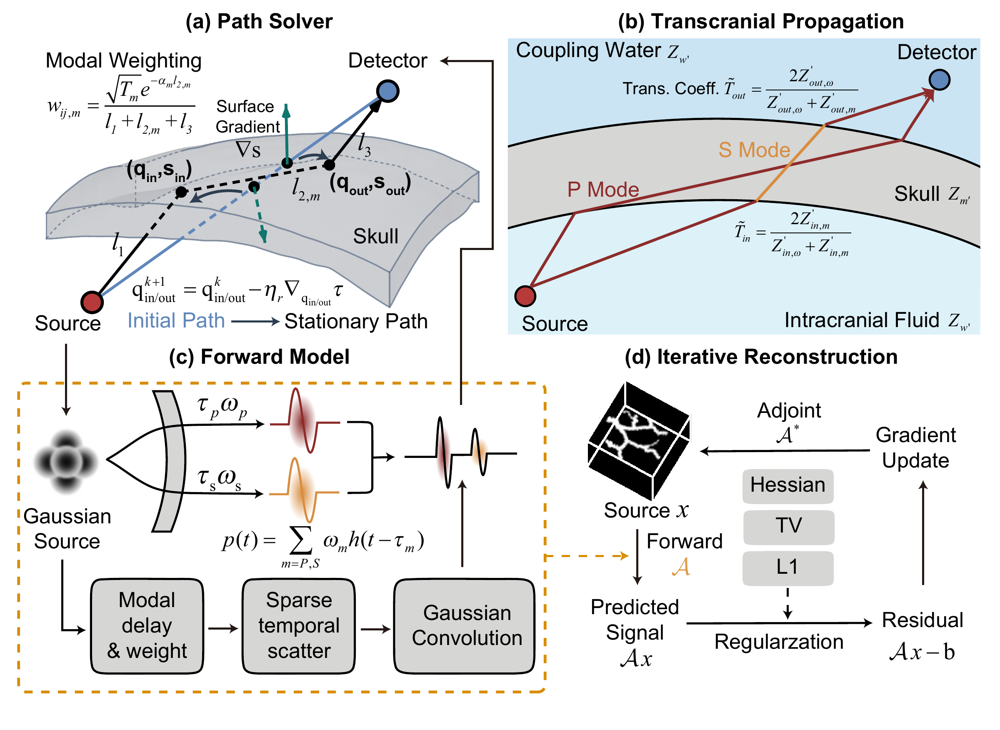
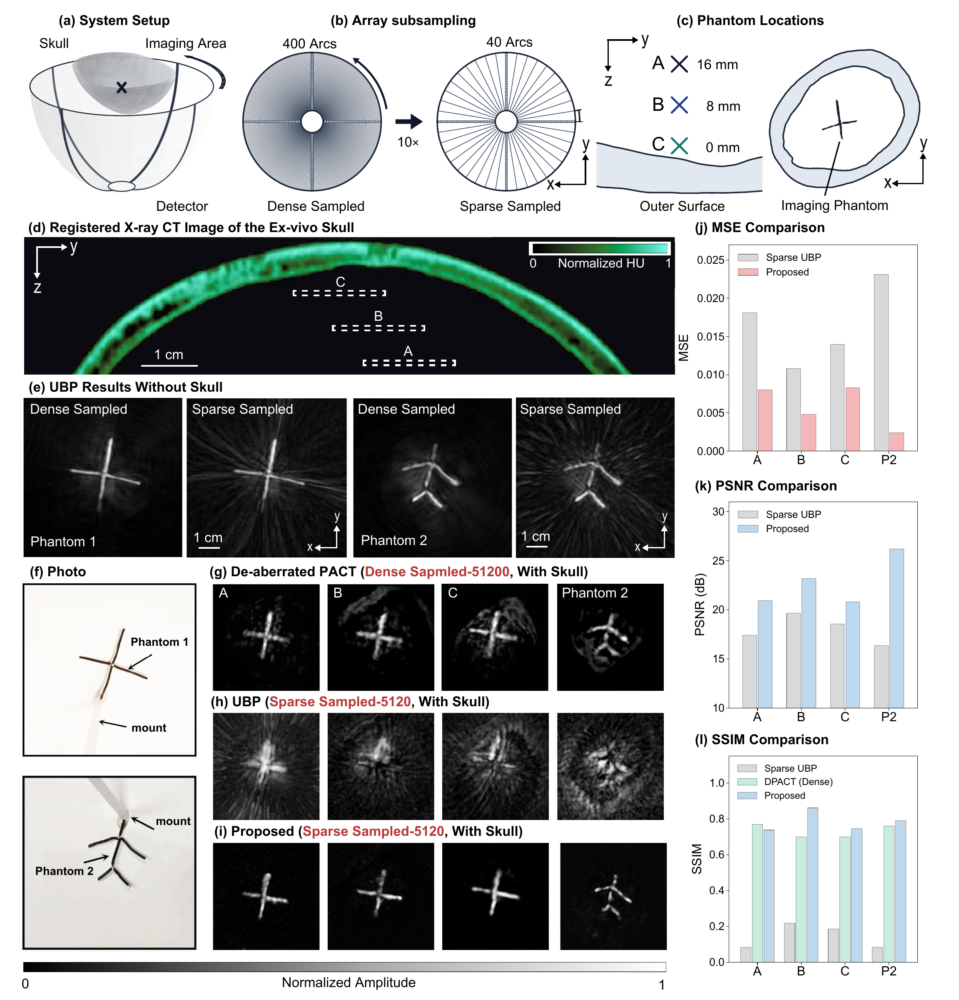

# SPIRIT: Super-fast Photoacoustic Iterative Reconstruction in Transcranial Imaging


SPIRIT is an ultrafast iterative reconstruction framework for transcranial photoacoustic imaging. It replaces exhaustive three-dimensional wave propagation simulations with a compact, differentiable asymptotic elastodynamic propagator that models both compressional- and shear-wave transmission while retaining essential refraction and mode conversion. The work demonstrates near real-time reconstruction on a consumer-grade GPU, over four orders of magnitude faster than traditional iterative methods, with validation in numerical simulations and ex vivo adult human skull experiments.


## Method

The differentiable propagator enables iterative reconstruction with a data-fidelity term and regularization. This repository provides three depth experiments (`a`, `b`, `c`) and one plane experiment (`plane`).



*Figure 1. Overview of SPIRIT: ray-path optimization, transcranial P/S-wave propagation, the differentiable forward model, and regularized iterative reconstruction.*



*Figure 2. Ex vivo human skull phantom experiments: imaging setup, detector subsampling, phantom locations, and reconstruction comparisons with quantitative image-quality metrics. Data in panels (d), (f), and (g) are from [Aborahama et al., Communications Physics (2026)](https://www.nature.com/articles/s42005-026-02545-3).*

## Experimental Data

The input MAT files will be uploaded separately. Download link: to be added.

Place the signal and detector-location files in `./data`, and the skull mask in `./data/skull`.

| Experiment | Signal file 
| --- | --- 
| `a` | `data/signal_ws_fig4_a.mat` |
| `b` | `data/signal_ws_fig4_b.mat` | 
| `c` | `data/signal_ws_fig4_c.mat` | 
| `plane` | `data/filtered_top_ws.mat` |

All experiments use `data/sensor_location.mat` (`sensor_location`) and `data/skull/skull_mask.mat` (`skull_mask`). Prepare these files before running; the entry point checks that the selected experiment's input files exist.

## Repository Structure

```text
.
|-- main.py                     # Unified experiment entry point
|-- experiments/
|   |-- depth/                  # Depth experiments a, b, c
|   `-- plane/                  # Plane experiment
|-- utils/                      # Experiment selection, execution, and output
|-- data/
|   |-- signal_ws_fig4_a.mat
|   |-- signal_ws_fig4_b.mat
|   |-- signal_ws_fig4_c.mat
|   |-- filtered_top_ws.mat
|   |-- sensor_location.mat
|   `-- skull/
|       `-- skull_mask.mat
|-- figure/                     # Method and reconstruction figures
|-- results/                    # Generated MAT files, images, and logs
`-- requirements.txt
```

## Installation

Use a CUDA-capable GPU with compatible PyTorch and Triton installations. Install the dependencies in your experiment environment:

```bash
python -m pip install -r requirements.txt
```

## Usage

Run from the repository root. Select one experiment, multiple experiments, or all experiments:

```bash
python main.py --experiment a
python main.py --experiment b
python main.py --experiment c
python main.py --experiment plane
python main.py --experiment a c plane
python main.py                      # Run all: a, b, c, plane
```

Results are saved to `results/<experiment>/<run-id>/`:

- `reconstruction.mat`: final 3D reconstruction, Z-MIP, center slice, coordinates, and reconstruction time.
- `reconstruction.png`: final reconstruction visualization.
- `original_figure_1.png`: the figure generated by the original experiment code.
- `console.log`:detector count, time samples per detector, grid dimensions and voxel count, sampling rate (Hz), voxel size (m), x/y/z spatial ranges (m), and final reconstruction time (s).

 Use the same input data and software/hardware environment when comparing reconstruction times.

## Citation

```bibtex
@misc{spirit,
  title  = {SPIRIT: Super-fast Photoacoustic Iterative Reconstruction in Transcranial Imaging},
  author = {Zhang, Yu and Zhou, Yucheng and Li, Shuang and Wang, Yibing and Cui, Manxiu and Sastry, Karteekeya and Wang, Lihong V. and Li, Changhui}
}
```
